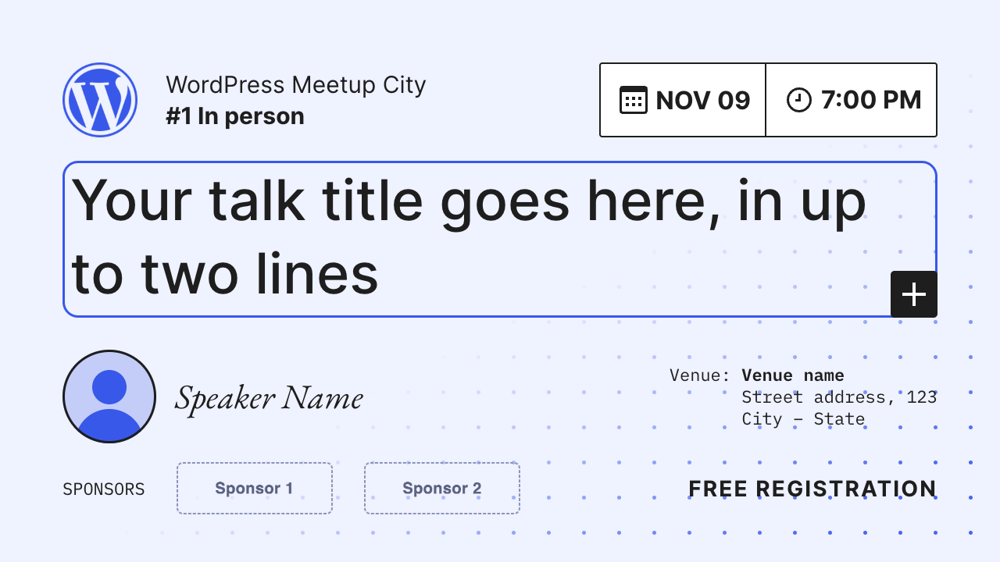
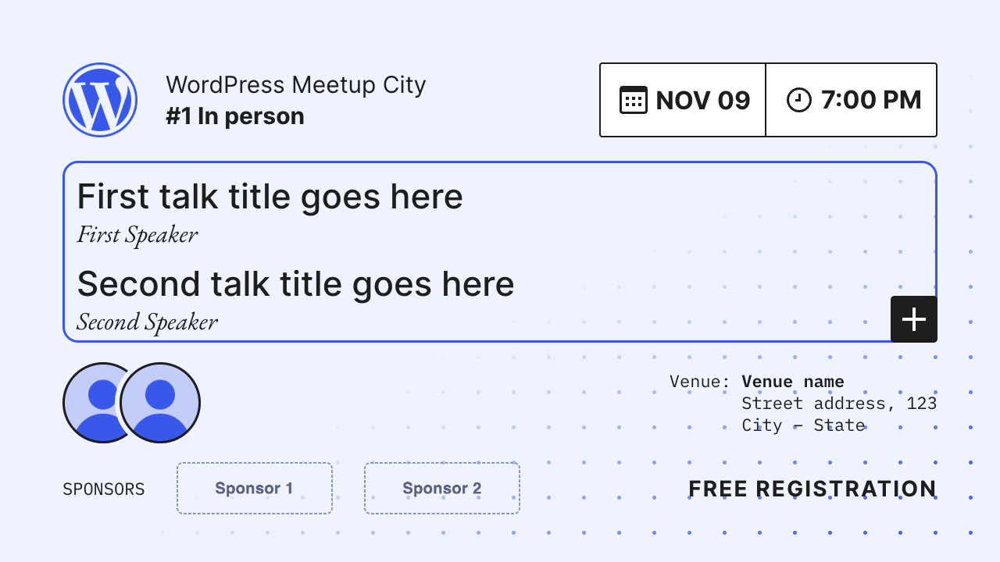
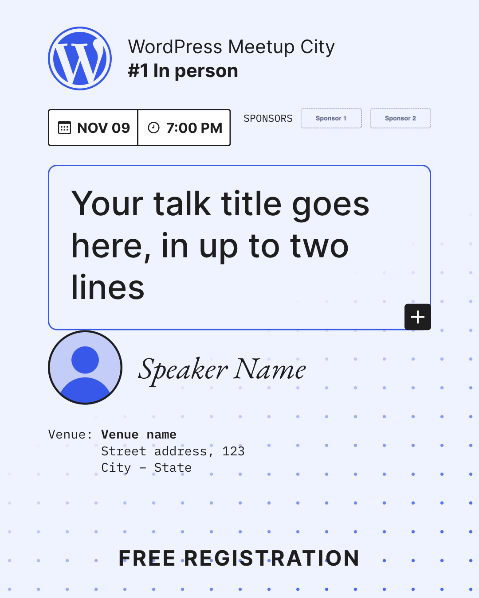
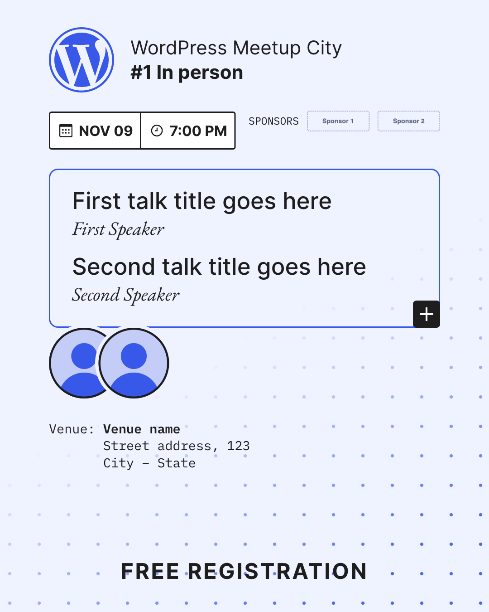
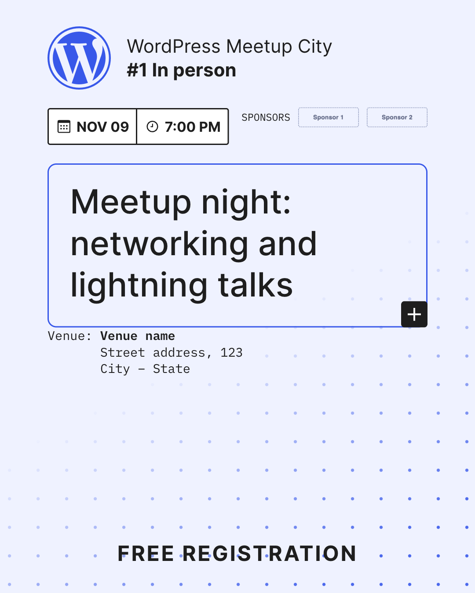

# Meetup Thumbnail Generator

Event thumbnails for WordPress meetups, made of core blocks and edited in the block editor.

**[Open in WordPress Playground →](https://playground.wordpress.net/?blueprint-url=https://raw.githubusercontent.com/camaleaun/meetup-thumbnail-generator/main/blueprint.json)**

The home page lists six thumbnails. Open one, then edit it to change the texts, photos and logos:

| | With sponsors | No sponsors |
| --- | --- | --- |
| **One speaker** | `/one-speaker-sponsors/` | `/one-speaker/` |
| **Two speakers** | `/two-speakers-sponsors/` | `/two-speakers/` |
| **No speaker** | `/no-speaker-sponsors/` | `/no-speaker/` |

Each page is two pieces in one, by the window width:

- **Event thumbnail (16:9):** 1280 × 720 from 576px up.
- **Instagram post (4:5):** below 576px; at 360 × 450 with device pixel ratio 3 it is 1080 × 1350.

  

## Export

In Chrome DevTools, turn on the device toolbar and set the size, then run "Capture screenshot" from the command menu:

- 1280 × 720, device pixel ratio 1: event thumbnail.
- 360 × 450, device pixel ratio 3: Instagram post.

## How it works

The plugin in [`meetup-thumbnail-generator/`](meetup-thumbnail-generator/):

- registers one block pattern per variation (category "Meetup thumbnail"), with the layout locked so only the content is edited (`templateLock: contentOnly`);
- registers the "Meetup thumbnail" page template: only the page content, without header, footer or admin bar;
- loads one stylesheet (`assets/style.css`) on the front end and in the editor, with Inter, EB Garamond and IBM Plex Mono bundled. With two speakers, the box holds both talks (title and speaker, one above the other) and the two photos partly overlap below it; without sponsors, the call to action stays on the right.

[`blueprint.json`](blueprint.json) installs the plugin from this repository and creates the pages (`mtg_install_demo()`).

Made for [WordPress Joinville](https://events.wordpress.org/group/wp-joinville/), from the Figma [Video thumbnail generator](https://www.figma.com/design/fxe7KNNVrz4KGLvQQR04tq/Video-thumbnail-generator--Community-) used by WordPress meetups in Brazil.

## License

Code: GPL-2.0-or-later. Fonts: SIL Open Font License 1.1 (see `assets/fonts/`). The WordPress logo is a trademark of the WordPress Foundation.
